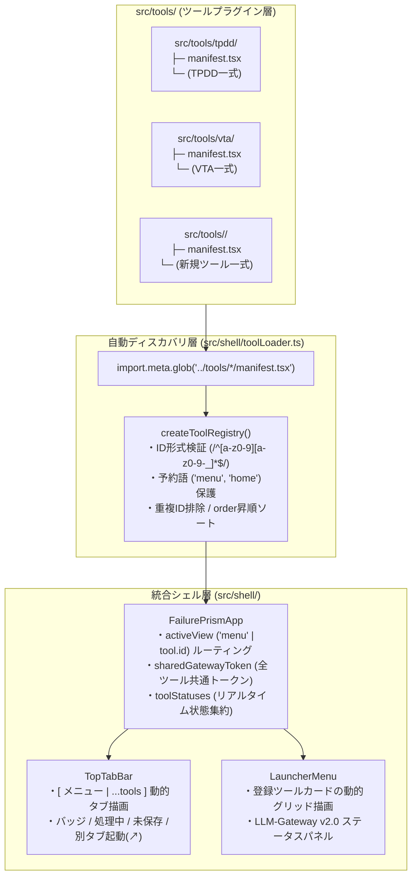

# FailurePrism オートプラグイン（ファイルベース・ディスカバリ）アーキテクチャ・プラグイン規約書

本ドキュメントは、**FailurePrism** 統合ワークベンチのアーキテクチャおよび新しいソフトウェア（ツール）を追加するための **プラグイン規約（Plugin Specification）** を定義します。

---

## 1. アーキテクチャ概要

FailurePrism は **「オープン・クローズドの原則（OCP）」** に基づくファイルベース・ディスカバリ（Auto-Plugin Discovery）アーキテクチャを採用しています。

- **統合シェル層 (`src/shell/`)**:
  - 個別ツールの内部実装や状態管理方式（React Context / Zustand / Redux 等）に関する知識を一切持たず、`src/tools/*/manifest.tsx` を自動検出してメニュー画面・トップタブバー・URLハッシュルーティング・常時マウント（Keep-Alive）コンテナを動的に構築します。
- **ツールプラグイン層 (`src/tools/<tool-id>/`)**:
  - ツールごとに独立した専用ディレクトリを持ち、直下に規約ファイル `manifest.tsx` を1つエクスポートするだけで、**既存のシェルや他ツールのコードを1行も変更することなく** ワークベンチへインストールされます。
  - ツールのアンインストール（除外）も、対象ディレクトリを削除または退避するだけで完結します。
- **共通ローカルAIバックエンド (`gateway/`)**:
  - フル機能版 `LLM-Gateway v2.0.0`（`127.0.0.1:8765`、Webサーバー経由で `/v1/*` および `/health` にリバースプロキシ）が全ツール共通の OpenAI 互換 API および組み込み GGUF 推論エンジンを提供します。



---

## 2. ディレクトリ構造規約

各ツールは `src/tools/<tool-id>/` 配下に専用ディレクトリを設け、直下に `manifest.tsx` を配置します。

```text
src/
  shell/
    types.ts                # プラグイン規約の型定義 (ToolManifest, ToolComponentProps 等)
    toolLoader.ts           # import.meta.glob による自動ディスカバリ & 検証レジストリ
    gatewayBridge.ts        # 動的URLハッシュ解決 (#menu, #<tool-id>) & Gatewayヘルスチェック
    TopTabBar.tsx           # 常設トップタブバー (登録ツールをループ描画)
    LauncherMenu.tsx        # 起動時ランチャーメニュー (登録ツールカードをループ描画)
    FailurePrismApp.tsx     # ルートシェル (Keep-Alive常時マウント & Gatewayトークン同期)
  tools/
    tpdd/                   # 思考展開図エディタ (TPDD-Editor)
      manifest.tsx
      ...
    vta/                    # バリエーションツリー解析エディタ (VTA-Editor)
      manifest.tsx
      ...
    <new-tool>/             # ★新規ツール追加時はここにディレクトリを作成するだけ
      manifest.tsx          # ★必須: ToolManifest をエクスポート
      App.tsx               # ツール本体コンポーネント
      ...
```

> [!IMPORTANT]
> ビルド時には `vite.config.ts` の `manualChunks` により、`src/tools/<tool-id>/` ごとに自動的に別々の JavaScript チャンク（`tool-<tool-id>-*.js`）へ分割されます。vite 設定を手動で編集する必要はありません。

---

## 3. プラグインマニフェスト規約 (`ToolManifest`)

`src/tools/<tool-id>/manifest.tsx` では、`src/shell/types.ts` で定義された `ToolManifest` 型のオブジェクトを `export const manifest: ToolManifest = { ... }`（または `export default`）としてエクスポートします。

### 3.1 `ToolManifest` フィールド仕様

| フィールド | 型 | 必須 | 説明 |
|---|---|---|---|
| `id` | `string` | **必須** | URLハッシュ（`#<id>`）やクエリ（`?app=<id>`）に使用される一意の識別子。<br>・正規表現 `/^[a-z0-9][a-z0-9-_]*$/` に一致する必要があります。<br>・`'menu'` および `'home'` はシェル予約語のため使用できません。 |
| `title` | `string` | **必須** | ツールの日本語正式名称（例: `'故障木解析エディタ'`）。メニュー画面の見出しやブラウザタブタイトルに使用されます。 |
| `subtitle` | `string` | 任意 | 英語表記やサブタイトル（例: `'Fault Tree Analysis Editor'`）。 |
| `shortTitle` | `string` | **必須** | トップタブバーや起動ボタンに表示される短い名称（例: `'FTA-Editor'`）。 |
| `description` | `string` | **必須** | ランチャーメニューのカードに表示される概要説明文。 |
| `features` | `string[]` | 任意 | ランチャーメニューのカード内に箇条書きで表示される主な機能一覧（3〜4項目推奨）。 |
| `icon` | `React.ComponentType<{ className?: string }>` | **必須** | タブバーおよびメニューカードに表示するアイコンコンポーネント（`lucide-react` アイコン等）。 |
| `theme` | `{ color: ToolThemeColor }` | 任意 | タブやカードのアクセント色。`'blue'` \| `'indigo'` \| `'emerald'` \| `'amber'` \| `'rose'` \| `'purple'` から選択（省略時は `'blue'`）。 |
| `order` | `number` | 任意 | メニューおよびタブバーでの表示順。数値が小さいほど左／先頭に表示されます（省略時は `99`、同値の場合は `id` の辞書順）。 |
| `component` | `React.ComponentType<ToolComponentProps>` | **必須** | ツールのルート React コンポーネント。 |

---

### 3.2 ルートコンポーネント規約 (`ToolComponentProps`)

統合シェルは登録された全ツールをマウント保持（Keep-Alive）し、各ツールの `component` に以下の Props を渡します。

```ts
export interface ToolComponentProps {
  /** 現在このツールタブがアクティブ（表示中）かどうか */
  isActive: boolean;
  /** シェル全体で共有されるインメモリ Gateway Token */
  gatewayToken: string;
  /** ツール内で Gateway Token が変更・削除された際にシェルへ通知するコールバック */
  onGatewayTokenChange: (token: string) => void;
  /** ツールのバッジ情報・未保存状態・Busy状態が変化した際にシェルへ通知するコールバック */
  onStatusChange?: (status: ToolRuntimeStatus) => void;
}
```

#### 実装上の必須ルール（ライフサイクル・分離規約）

1. **状態管理プロバイダの自己完結**:
   - ツールが React Context（`<AppProvider>` 等）を使用する場合は、必ずツールの `component` 内部で Provider をラップしてください。統合シェル側に Provider を追加してはいけません。
2. **非アクティブ時（`isActive === false`）のグローバルイベント遮断**:
   - 統合シェルはタブ切替時に編集状態を失わないよう、非アクティブなツールも DOM 上で `hidden` としてマウントし続けます。
   - そのため、`window.addEventListener('keydown', ...)` 等のグローバルイベントや `document.body` へのポータルモーダルを使用する場合は、**必ず `if (!isActive) return;` でガード**し、他ツールの操作に干渉しないようにしてください。
3. **Gateway Token の共有（任意）**:
   - ツールが `LLM-Gateway` のクライアント認証トークン入力欄を持つ場合、Props の `gatewayToken` と `onGatewayTokenChange` を双方向バインドすることで、他ツールとメモリ内で自動的にトークンを共有・同期できます（セキュリティ規約上、トークンを `localStorage` 等の永続ストレージに保存しないでください）。
4. **リアルタイムステータスの通知（任意）**:
   - ノード数、未保存フラグ（`isDirty`）、AI推論実行中フラグ（`isBusy`）などを `onStatusChange` で通知すると、トップタブバーやランチャーメニューのバッジにリアルタイム反映されます。

---

## 4. 新規ツールの追加チュートリアル（最小実装例）

例として、新しいツール **FTA-Editor (`id: 'fta'`)** を追加する場合、以下の1ファイル（またはフォルダ一式）を作成するだけで完了します。

### `src/tools/fta/manifest.tsx`

```tsx
import React, { useEffect } from 'react';
import { GitMerge } from 'lucide-react';
import { ToolComponentProps, ToolManifest } from '../../shell/types';

const FTAToolApp: React.FC<ToolComponentProps> = ({
  isActive,
  gatewayToken,
  onGatewayTokenChange,
  onStatusChange,
}) => {
  // 1. ステータスバッジの通知
  useEffect(() => {
    onStatusChange?.({
      badgeCount: 0,
      badgeTooltip: '0 事象',
      isDirty: false,
      isBusy: false,
    });
  }, [onStatusChange]);

  // 2. グローバルショートカットを使う場合は isActive でガードする
  useEffect(() => {
    if (!isActive) return;
    const onKeyDown = (e: KeyboardEvent) => {
      // FTA固有のショートカット処理
    };
    window.addEventListener('keydown', onKeyDown);
    return () => window.removeEventListener('keydown', onKeyDown);
  }, [isActive]);

  return (
    <div className="flex-1 h-full w-full bg-slate-50 text-slate-900 p-6">
      <h1 className="text-xl font-bold">FTA-Editor (故障木解析エディタ)</h1>
    </div>
  );
};

export const manifest: ToolManifest = {
  id: 'fta',
  title: '故障木解析エディタ',
  subtitle: 'Fault Tree Analysis Editor',
  shortTitle: 'FTA-Editor',
  description: '頂上事象から基本事象への論理ゲート（AND/OR）展開を行い、最小カットセットや発生確率を評価するツールです。',
  features: [
    'AND / OR 論理ゲートによるトップダウン故障木モデリング',
    '最小カットセット（MCS）の自動算出と重要度解析',
    'LLM-Gateway 連携による基本事象の抜け漏れチェック',
  ],
  icon: GitMerge,
  theme: { color: 'emerald' },
  order: 30,
  component: FTAToolApp,
};

export default manifest;
```

上記ファイルを配置して `npm run dev` または `npm run build` を実行すると、以下がすべて自動で有効になります。
1. 起動時のランチャーメニュー（`#menu`）に **FTA-Editor** のカードが追加される。
2. 画面上部の常駐タブバーに **FTA-Editor** タブと別タブ起動ボタン（`↗`）が追加される。
3. URLハッシュ `#fta` および `?app=fta` での直接起動・ブラウザタブ間切替が有効になる。
4. 本番ビルド時に `dist/assets/tool-fta-*.js` として独立チャンクに分割される。
