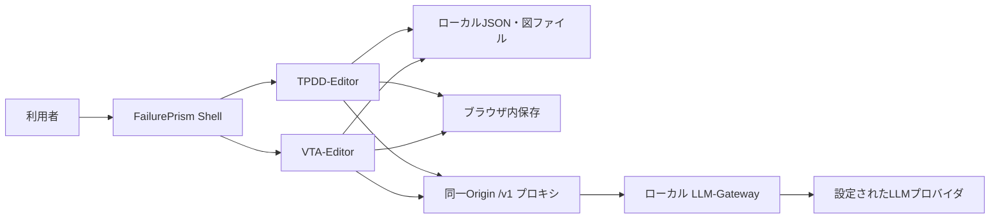

# FailurePrism 要件定義書・共通要件

| 項目 | 内容 |
| --- | --- |
| 文書版 | 1.0（実装からの再構成） |
| 作成日 | 2026-10-18 |
| 対象 | FailurePrism 1.0.0、VTA-Editor、TPDD-Editor |
| 実装基準 | Gitコミット `493c052`（bug fix）。調査開始時の追跡対象ファイルに未コミット変更なし |
| 個別文書 | [VTA-Editor要件定義書](vta/REQUIREMENTS.md)、[TPDD-Editor要件定義書](tpdd/REQUIREMENTS.md) |

## 1. 文書の位置付け

本書群は、現在のソースコードに存在する機能・データ・制御から、保守開発と受入確認に使える要件を再構成したものである。正式な発注仕様や利用者による合意を代替しない。「想定利用者」「業務目的」は画面と処理からの推定であり、業務責任者との合意が必要である。

機能要件の「〜できること」「〜すること」は現行実装に対応する期待動作を表す。要件表の実装根拠はコード確認を意味し、すべての環境で受入試験に合格済みという意味ではない。実装上の制約・不一致は各文書末尾へ分離し、既知の不具合を意図した仕様として固定しない。受入条件は今後の検証基準であり、試験実施結果ではない。

根拠の優先順位は、実行経路のコード、スキーマ・定数、既存テスト、説明コメント、旧ドキュメントの順とする。型に宣言されているだけで保存・UI操作につながらない項目は、実装済み要件に含めない。

## 2. システム境界と利用者

想定利用者は、設計要求を構造化する設計担当者、事故・不具合の調査担当者、図や分析結果を確認するレビュー担当者、およびGatewayを設定する端末管理担当者である。アプリ内のログイン、役割別権限、承認ワークフローは実装されていない。

エディタはブラウザで図の編集・検証・ファイル生成を行う。AI機能はGatewayと上流モデルに依存する。GatewayのEmbedding/Rerank機能は同梱されるが、両エディタが直接利用する機能要件には含めない。TPDDとVTA間の図データ変換も対象外である。

## 3. 共通機能要件

| ID | 要件 | 実装根拠 | 受入条件 |
| --- | --- | --- | --- |
| COM-01 | メニューから各エディタを選択でき、`#menu`、`#tpdd`、`#vta`で表示先を指定できること | [gatewayBridge.ts](../src/shell/gatewayBridge.ts)、[FailurePrismApp.tsx](../src/shell/FailurePrismApp.tsx) | URLによる起動、アプリ内切替、ブラウザの戻る・進むで表示が一致する |
| COM-02 | アプリ内切替でエディタのマウントを維持し、作業状態・履歴・実行中処理を保持すること | FailurePrismApp.tsx | 編集後に往復して内容と履歴が残る。切替だけではAI処理を中止しない |
| COM-03 | 非表示ツールのキャンバス操作をキーボード入力から隔離すること | 各App/CanvasのisActive制御 | 片方で選択を残し、他方でDelete・矢印・Undoを実行しても非表示側を変更しない |
| COM-04 | 別ブラウザタブでエディタを開けること | [TopTabBar.tsx](../src/shell/TopTabBar.tsx)、gatewayBridge.ts | 別タブで指定ツールが開く。メモリ内の編集中データを自動複製・同期する機能とは扱わない |
| COM-05 | ノード件数等のツール状態とGateway稼働状態をShellへ表示すること | 各manifest.tsx、TopTabBar.tsx | 編集で件数が更新され、VTAの未保存・処理中状態が表示される |
| COM-06 | 同一Shell内でGateway Tokenの追加・更新・削除を共有し、Tokenを永続保存しないこと | FailurePrismApp.tsx、各manifest.tsx | 一方の変更が他方へ反映され、JSON・localStorage・IndexedDBにTokenが含まれない |
| COM-07 | 既定のAI接続先を`/v1`とし、選択したモデルIDをGatewayへ渡すこと | 各LLMクライアント、[server.mjs](../scripts/server.mjs) | モックGatewayでモデル・メッセージ・認証ヘッダーを確認できる |
| COM-08 | Gateway停止中も基本編集、ローカル保存、図出力を利用できること | 各エディタの編集・出力処理 | Gatewayを使わずに手動編集→保存→読込→図出力できる |
| COM-09 | 通信失敗・キャンセル・処理状況を利用者に知らせること | 各通知・LLMクライアント | 接続失敗やタイムアウトを無反応にせず表示し、編集を継続できる |

## 4. 外部インターフェース・運用前提

| 項目 | 現行実装 |
| --- | --- |
| 配布形態 | Windows用起動・停止スクリプト、Node.js Webサーバー、ビルド済みブラウザUI、Gateway/管理GUI |
| 標準URL | `http://127.0.0.1:3000/`。開発時Viteを利用 |
| Gateway | 標準ポート8765。Webサーバーが`/v1`系および`/health`を中継 |
| モデル一覧 | `GET /v1/models`。取得結果とローカルのモデルカタログをUIで利用 |
| 推論 | `POST /v1/chat/completions`、OpenAI互換messages形式 |
| 稼働確認 | Shellから`/health`、直接接続先の順に確認。定期確認15秒、各試行3秒 |
| Client認証 | Gateway TokenをBearerとして送信。TPDDは認証有効設定に従い、VTAは非空Tokenを送信 |
| Provider認証 | Gateway側の資格情報管理。エディタのTokenとは別の資格情報 |
| 初期モデル | 両ツールの定数は`openrouter/google/gemini-3.8-flash`。実際の提供・利用可能性を保証しない |
| ブラウザ機能 | SVG、Fetch、AbortController、Blobダウンロード、localStorage、TPDDはIndexedDB、VTAはPDF Worker等を利用 |

ブラウザで文書をテキスト化する段階と、抽出・推論のためにそのテキストを上流へ送る段階は分けて扱う。クラウドプロバイダを選んだ場合に「データが端末外へ出ない」とは定義しない。手動JSON保存はブラウザのダウンロードを起動する処理であり、任意の既存ファイルを直接上書きするAPIではない。

## 5. 非機能要件と未確定事項

| ID | 要件・基準 | 確認方法／制約 |
| --- | --- | --- |
| COM-N01 | 秘密情報をエディタの永続モデルから分離すること | 保存ファイル・ブラウザストレージを確認。端末自体のアクセス制御は運用側 |
| COM-N02 | AI結果を構造検証し、不正な参照をそのまま図へ適用しないこと | 各AI検証関数の境界・異常系テスト |
| COM-N03 | XML文字列をエスケープし、標準SVGとして図を出力すること | 出力テストと対象ビューアでの目視。Officeの全バージョン互換は未保証 |
| COM-N04 | 確定編集と表示専用状態を区別し、必要な編集を取り消せること | 個別文書の履歴範囲に従う。UI状態まで完全にUndoする要件ではない |
| COM-N05 | TypeScript型検査、自動テスト、本番ビルドを品質確認に用いること | `npm run typecheck`、`npm test`、`npm run build`。合格は実ブラウザ試験の代替ではない |

応答時間SLA、最低ハードウェア、対応ブラウザの確定版数、画面幅の最低値、アクセシビリティ適合水準、文書読込の最大バイト数（VTA）、AI品質の数値合格基準は、現行実装だけから合意済み要件として確定できない。旧文書の「快適」「完全互換」「達成」は測定結果なしに再利用しない。

共同編集、クラウド同期、ユーザー管理、監査証跡、AI出力の正しさの保証、OCR、ブラウザ保存領域消去後の復旧は、実装から確認できる対象範囲に含めない。

## 6. 受入・変更管理

個別文書の受入条件と既存テストの対応を確認し、未実施のブラウザ操作・実Gateway試験を別途計画する。文書作成時にはソース照合を行い、業務責任者の承認や新たな実機受入試験は行っていない。将来要件を変更するときは、要件ID、実装根拠、受入条件、制約欄を同時に更新する。

既存の[TPDD仕様書](tpdd/SPECIFICATION.md)・[VTAリファレンス](vta/REFERENCE.md)は設計資料として併存させる。相違時はこの基準コミットの実装事実を確認し、将来の期待動作を決定する。過去のレビュー指摘は、その後の修正を確認せず現行の未解決事項として扱わない。
