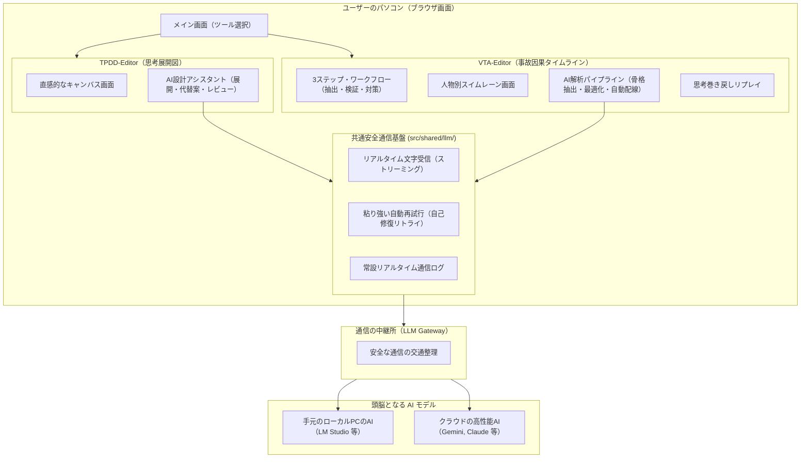
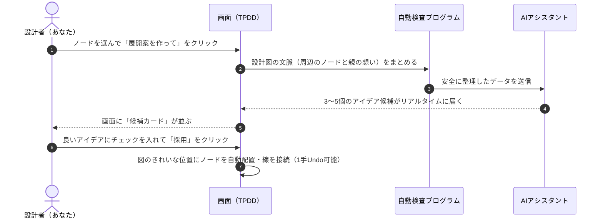
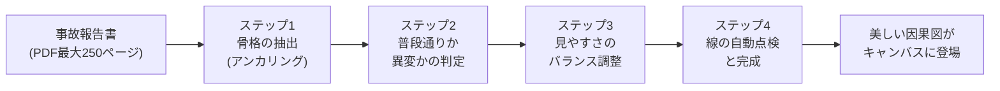

# FailurePrism: TPDD & VTA アーキテクチャ解説書（やさしい技術ガイド）

本書は、システム設計・要求展開ツール **TPDD-Editor**（Thinking Process Decomposition Diagram: 思考展開図）と、事故・インシデント因果分析ツール **VTA-Editor**（Variation Tree Analysis: 変動樹解析）の仕組み、AIとの連携フロー、および最新の安全設計を、ソフトウェアの専門家でなくても直感的に理解できるように解説した総合ドキュメントです。

---

## 目次

1. [全体像：FailurePrism が目指す世界](#1-全体像failureprism-が目指す世界)
   - 1.1 [「ものづくり（設計）」と「事故調査（失敗分析）」の表裏一体](#11-ものづくり設計と事故調査失敗分析の表裏一体)
   - 1.2 [なぜ AI にすべてを任せないのか？（人間の判断と自動防壁）](#12-なぜ-ai-にすべてを任せないのか人間の判断と自動防壁)
   - 1.3 [システム全体の鳥瞰図](#13-システム全体の鳥瞰図)
2. [AI との安全・確実な通信基盤（共通機能）](#2-ai-との安全確実な通信基盤共通機能)
   - 2.1 [文字が1つずつ届いて安心できる仕組み（リアルタイムストリーミング）](#21-文字が1つずつ届いて安心できる仕組みリアルタイムストリーミング)
   - 2.2 [回線が途切れても自動で粘り強くつなぎ直す（自己修復リトライ）](#22-回線が途切れても自動で粘り強くつなぎ直す自己修復リトライ)
   - 2.3 [秘密や不要な情報を AI に渡さないプライバシー保護](#23-秘密や不要な情報を-ai-に渡さないプライバシー保護)
   - 2.4 [画面を覆い隠さず作業とログを見守るノイズフリー進捗表示（ADR-0028）](#24-画面を覆い隠さず作業とログを見守るノイズフリー進捗表示adr-0028)
3. [TPDD-Editor（思考展開図）：やりたいことから仕組みを組み立てる](#3-tpdd-editor思考展開図やりたいことから仕組みを組み立てる)
   - 3.1 [どんな図を作るのか？（要求 $\to$ 機能 $\to$ 仕組みの階段ピラミッド）](#31-どんな図を作るのか要求--機能--仕組みの階段ピラミッド)
   - 3.2 [複雑な設計をスッキリ整理する「詳細図（サブ図への潜り込み）」](#32-複雑な設計をスッキリ整理する詳細図サブ図への潜り込み)
   - 3.3 [AI と一緒にアイデアを広げる流れ（展開案・代替案・レビュー）](#33-ai-と一緒にアイデアを広げる流れ展開案代替案レビュー)
   - 3.4 [なぜ AI は的外れにならないのか？（5階層上までの想いを伝える「系譜」）](#34-なぜ-ai-は的外れにならないのか5階層上までの想いを伝える系譜)
   - 3.5 [設計の理由を自動で文章化する「要求レポート生成」](#35-設計の理由を自動で文章化する要求レポート生成)
4. [VTA-Editor（事故因果タイムライン）：起きてしまった事故の真相を解き明かす](#4-vta-editor事故因果タイムライン起きてしまった事故の真相を解き明かす)
   - 4.1 [どんな図を作るのか？（人物ごとの縦コース「スイムレーン」× 時間軸）](#41-どんな図を作るのか人物ごとの縦コーススイムレーン--時間軸)
   - 4.2 [直感的な3ステップ・ワークフロー（抽出 ➔ 検証 ➔ 対策）（ADR-0029）](#42-直感的な3ステップワークフロー抽出--検証--対策adr-0029)
   - 4.3 [図がごちゃごちゃしないためのスマートな表示ルール（ADR-0003, ADR-0026）](#43-図がごちゃごちゃしないためのスマートな表示ルールadr-0003-adr-0026)
   - 4.4 [人間と機械のメンタルモデル不整合（Mode Confusion）と装置の主役化（ADR-0033）](#44-人間と機械のメンタルモデル不整合mode-confusionと装置の主役化adr-0033)
   - 4.5 [事故報告書から図が完成するまでの4つのステップ](#45-事故報告書から図が完成するまでの4つのステップ)
   - 4.6 [失敗を科学する：SRKモデルと失敗学三大要因による変動分類（ADR-0031）](#46-失敗を科学するsrkモデルと失敗学三大要因による変動分類adr-0031)
   - 4.7 [正の変動（Teal）と負の変動（Amber）：Safety-II レジリエンスと機能縮退（ADR-0031, ADR-0033）](#47-正の変動tealと負の変動amber--safety-ii-レジリエンスと機能縮退adr-0031-adr-0033)
   - 4.8 [精神論を排した工学的AI対策推薦（排除・ブレイク）と分析レポート（ADR-0031）](#48-精神論を排した工学的ai対策推薦排除ブレイクと分析レポートadr-0031)
   - 4.9 [AI の思考プロセスを巻き戻して見られる「動的リプレイ」（ADR-0021）](#49-ai-の思考プロセスを巻き戻して見られる動的リプレイadr-0021)
   - 4.10 [AI の小さな間違いを自動で直して救出する「多層自己治癒機能」（ADR-0024, ADR-0027, ADR-0030, ADR-0032）](#410-ai-の小さな間違いを自動で直して救出する多層自己治癒機能adr-0024-adr-0027-adr-0030-adr-0032)
   - 4.11 [困ったときにワンクリックで相談できる「AI診断パッケージ」（ADR-0009, ADR-0025, ADR-0030）](#411-困ったときにワンクリックで相談できるai診断パッケージadr-0009-adr-0025-adr-0030)
5. [TPDD と VTA の比較まとめ（ひと目でわかる対比表）](#5-tpdd-と-vta-の比較まとめひと目でわかる対比表)

---

## 1. 全体像：FailurePrism が目指す世界

### 1.1 「ものづくり（設計）」と「事故調査（失敗分析）」の表裏一体

エンジニアリングの世界において、新しいものを作ることと、起きてしまった失敗から学ぶことは、コインの表と裏のような関係です。

```
【未来へ向かう道：設計】                【過去を振り返る道：分析】
   TPDD-Editor                           VTA-Editor
「こんな装置を作りたい」               「なぜ事故が起きてしまったのか？」
        ↓                                     ↑
 [目的・要求]                               [重大な結末（衝突・破壊）]
        ↓                                     ↑
 [必要な機能]                               [指示の聞き間違い・判断の遅れ]
        ↓                                     ↑
 [具体的な仕組み]                           [普段通りの日常作業]
```

- **TPDD-Editor（演繹的・前方展開）**:
  「事故を起こさない安全な車を作りたい」といった抽象的な願いから出発し、「自動でブレーキをかける機能」「カメラで前方を検知するレーダー機構」へと、左から右へ具体化していく**未来への設計図**です。
- **VTA-Editor（帰納的・後方再構成）**:
  航空機衝突や鉄道事故など、実際に起きてしまった悲惨な事故調査報告書を読み解き、「何が最後の引き金になったのか」「誰がどの瞬間に判断を誤ったのか」を時間軸に沿って解き明かす**過去からの学びの図**です。

---

### 1.2 なぜ AI にすべてを任せないのか？（人間の判断と自動防壁）

最近の生成 AI（ChatGPT、Claude、Gemini など）は非常に賢いですが、**「もっともらしい嘘をつく（幻覚・ハルシネーション）」**や**「指示を忘れて変な形式で答える」**という弱点があります。人命や安全に関わる設計・事故調査において、AI の言うことをそのまま鵜呑みにすることは絶対にできません。

そのため、FailurePrism では以下の **「3つの安全原則」** を徹底しています：

1. **AI に勝手に図を書き換えさせない（Human-in-the-Loop: 人間の最終確認）**:
   AI はあくまで「アイデアを提案する助手」です。図に新しいノードを追加したり、事故の判定を変えるときは、必ず人間の画面に選択肢として表示し、人間がチェックを入れて「採用」ボタンを押したときだけ図に反映されます。元に戻す（Undo）も1手で可能です。
2. **AI の出力をプログラムが厳しく検問する（決定論的ガードレール）**:
   AI が出力したテキストは、アプリ内部の検証プログラムが1行ずつチェックします。「実在しない段落番号を引用していないか」「勝手に登場人物を捏造していないか」を自動点検し、怪しい内容は自動で除外または警告を出します。
3. **データ本体と画面表示を切り離す（非破壊アーキテクチャ）**:
   図の見栄えをスッキリさせるために登場人物をまとめたり展開したりしても、報告書から読み取った元データ（誰が何をしたかという純粋な事実）は1文字も壊さず大切に裏側で保管されます。

---

### 1.3 システム全体の鳥瞰図

FailurePrism は、Webブラウザ上で軽快に動作するフロントエンドと、手元のPCやクラウドの AI を安全につなぐ中継役（LLM Gateway）で構成されています。



---

## 2. AI との安全・確実な通信基盤（共通機能）

### 2.1 文字が1つずつ届いて安心できる仕組み（リアルタイムストリーミング）

長い報告書を解析するとき、AI は数分間にわたって何千文字もの文章を考え続けます。もし昔ながらの通信方法だと、AI がすべて書き終えるまで画面が「通信中...」のまま固まってしまい、ユーザーは「動いているのか？ フリーズしたのか？」と不安になり、思わず画面を閉じてしまいます。

FailurePrism では **「ストリーミング通信」** を採用しています：
- AI が言葉を思いつくたびに、1文字・1行単位でリアルタイムに画面へ届きます。
- 画面上には「**累計 1,500文字受信中（経過: 45秒、速度: 約30文字/秒）**」といった進捗がリアルタイムに表示されるため、AI が順調に仕事をしていることが一目で分かります。

### 2.2 回線が途切れても自動で粘り強くつなぎ直す（自己修復リトライ）

遠くのパソコンに VPN（Tailscale など）経由で接続しているときや、AI のサーバーが混雑しているときは、一瞬通信が切れたりエラー（混雑エラー 429、一時的不通 502/503/504 など）が出ることがあります。

普通なら「通信エラー」と出て最初からやり直しになりますが、FailurePrism は **「自動でちょっと待ってから、そっと再接続を試みる」** 仕組みを備えています：
- サーバーから「10秒待ってね」と言われたら素直に10秒待ち、指定がなければ少しずつ待つ時間を延ばしながら（1秒 $\to$ 2秒 $\to$ 4秒）最大3回まで自動で粘り強くトライします。
- 通信が一時的に切れても、ユーザーが気づかないうちに自動で復活して処理を最後までやり遂げます。

### 2.3 秘密や不要な情報を AI に渡さないプライバシー保護

- **内部IDの隠蔽**: アプリ内部で使っている管理番号（UUIDと呼ばれる英数字の長いID）は AI に見せません。「K1（要求種別）」「N1（1番目のノード）」といった一時的な整理番号に変換して AI に渡し、AI から返ってきた番号をアプリ側で正しい内部データに戻します。
- **パスワード・トークンの厳重保管**: AI を使うための認証キー（APIトークン）は、パソコンの一時メモリにだけ保持し、保存ファイル（JSON）やブラウザの保存領域には絶対に書き込みません。ファイルを誰かにメールで送っても、パスワードが漏れる心配はありません。

### 2.4 画面を覆い隠さず作業とログを見守るノイズフリー進捗表示（ADR-0028）

AI が思考している間、画面全体をすりガラスのようにぼかしてしまうと、背後で動いている通信ログやこれまでの作業内容が一切読めなくなり、不安感を助長します。
FailurePrism では **背景ぼかし（`backdrop-blur`）を完全撤廃** しました。
背面のキャンバスや左パネルの常設ログを100%鮮明に可読な状態に保ち、中央の進捗ダイアログ内にも最新の通信ログを1行ずつリアルタイム表示することで、ストレスなく処理を見守ることができます。

---

## 3. TPDD-Editor（思考展開図）：やりたいことから仕組みを組み立てる

### 3.1 どんな図を作るのか？（要求 $\to$ 機能 $\to$ 仕組みの階段ピラミッド）

TPDD（思考展開図）は、**「左から右へ進むほど、話が具体的になる」** というシンプルな階段状のキャンバスです。

```
 [要求列 (Level 1)]          [機能列 (Level 2)]          [機構列 (Level 3)]
┌─────────────────┐       ┌─────────────────┐       ┌─────────────────┐
│ 衝突事故を防ぐ   │ ──分解─▶ │ 車両を安全に減速 │ ──分解─▶ │ 油圧ディスク    │
│ (最上位の目的)   │       │ させる           │       │ ブレーキ        │
└─────────────────┘       └─────────────────┘       └─────────────────┘
                                   │
                                   └──分解─▶ ┌─────────────────┐
                                             │ 回生ブレーキ    │
                                             └─────────────────┘
```

- **分解（Decomposition）**: 親から子へ向かうメインの矢印。「この目的を果たすために、具体的にこれらを作る」という関係です。
- **依存（Dependency）**: 「Aが動くためには、Bの電源が必要」といった横のつながり。
- **制約（Constraint）**: 「コストは1万円以内」「重さは5kg以下」といった設計の縛り。
- **参考・代替（Reference）**: 「別の方法として、こんな機構も考えられる」というメモ。

### 3.2 複雑な設計をスッキリ整理する「詳細図（サブ図への潜り込み）」

大きなシステムを1枚の紙に書こうとすると、ノードが何百個にも増えて巨大なクモの巣になり、人間には読めなくなります。

TPDD では、ノードをダブルクリックすると **「そのノードの中身だけの新しい下位図面（サブ図）」** に潜り込むことができます。
たとえば、「エンジン制御」というノードの中に潜り込むと、そこだけに特化した新しい「要求 $\to$ 機能 $\to$ 機構」の図が広がります。どれだけ巨大なシステムでも、何階層にもきれいに整理して設計できます。

### 3.3 AI と一緒にアイデアを広げる流れ（展開案・代替案・レビュー）



設計者が「この機能、具体的にどう作ればいいかな？」と迷ったとき、ノードを選んでボタンを押すだけで、AI が教科書や過去の設計知識をもとに「こんな方法はどうですか？」と候補を3〜5個提案してくれます。気に入ったものだけを選んで図に取り込めます。

### 3.4 なぜ AI は的外れにならないのか？（5階層上までの想いを伝える「系譜」）

AI に「ブレーキを作って」とだけ伝えると、自転車用なのか新幹線用なのか分からず、見当違いな回答をしてしまいます。

TPDD は、AI に質問を送るときに、そのノードの **「最大5階層上までの先祖（親、おじいちゃん、ひいおじいちゃん...）の想い」** を自動で調べ上げて、「このブレーキは、一番上の『時速300kmで走る新幹線の安全停止』という要求から生まれたものですよ」という文脈（系譜: `ancestry`）をそっと耳打ちします。これにより、AI は常に設計全体の目的からブレない的確な提案をしてくれます。

### 3.5 設計の理由を自動で文章化する「要求レポート生成」

図面が完成したら、ボタン1つで上司や取引先に提出できる **「設計要求仕様書（Markdown形式のレポート）」** を自動生成できます。
ここでも AI の勝手な作文を防ぐため、「図の中に実在する矢印やノードを引用していない文は自動でバッサリ切り捨てる」という厳格な事実チェック（根拠検証）を行っています。

---

## 4. VTA-Editor（事故因果タイムライン）：起きてしまった事故の真相を解き明かす

### 4.1 どんな図を作るのか？（人物ごとの縦コース「スイムレーン」× 時間軸）

VTA（Variation Tree Analysis: 変動樹解析）は、プールのコース（スイムレーン）のように **「登場人物や組織ごとに縦の列を分け、上から下へ（あるいは下から上へ）時間の流れに沿って出来事を並べる図」** です。

```
 [海上保安庁機（機長）]     [羽田管制塔（管制官）]     [日本航空機（旅客機）]
         │                            │                            │
   ┌───────────┐                      │                            │
   │ C5誘導路へ │                      │                            │
   │ 進入した   │                      │                            │
   └───────────┘                      │                            │
         │                            │                            │
         │                      ┌───────────┐                      │
         │ ◀──── 指示・連絡 ──── │ 着陸許可を│ ──── 指示・連絡 ───▶ │
         │   「No.1へ走行せよ」 │ 発出した  │   「着陸支障なし」    │
         │                      └───────────┘                      │
         ▼                            │                            ▼
   ┌───────────┐                      │                      ┌───────────┐
   │ 滑走路内に │                      │                      │ 滑走路へ  │
   │ 進入停止   │ ◀══════════ 衝突・炎上（帰結） ═══════════ │ 着地・進入│
   └───────────┘                                             └───────────┘
```

誰が誰にどんな無線連絡を送り、誰が何を見落として滑走路に入ってしまったのかという「人と人とのやりとりの連鎖」が一目で分かります。

---

### 4.2 直感的な3ステップ・ワークフロー（抽出 ➔ 検証 ➔ 対策）（ADR-0029）

従来の事故分析ツールは、たくさんのボタンや機能が画面に散らばっており、「いま何をすればいいのか」が分かりにくいという課題がありました。
VTA-Editor では、分析者の思考プロセスに寄り添った **「3ステップ・タブ」** に再編されました：

```
┌────────────────────────────────────────────────────────┐
│  [① 抽出・読込]    [② 検証・精緻化]    [③ 対策・改善生成]  │
└────────────────────────────────────────────────────────┘
```

1. **ステップ①【抽出・読込】**:
   事故報告書（PDFやテキスト）を読み込ませ、AI に骨格となるタイムラインを自動抽出させます。
2. **ステップ②【検証・精緻化】**:
   AI の抽出結果を人間が監査・微調整します。呼称統一や主観表現のチェック、仮判定の一括採用、接続線の自動補完（Chain Repair）を行います。
3. **ステップ③【対策・改善生成】**:
   完成した因果図をもとに、AI に工学的な再発防止策（排除・ブレイク）を提案させ、「改善された業務フロー」や「8章構成の分析・対策レポート」を出力します。
- **常設通信ログエリア**: 左パネル下部に常にAIとの通信状況が表示され、安心感を保ちながら作業を進められます。

---

### 4.3 図がごちゃごちゃしないためのスマートな表示ルール（ADR-0003, ADR-0026）

報告書には何十人もの関係者と何百もの出来事が登場します。すべてを同じ四角いカードで描くと線が絡まり合って読めなくなります。そこで VTA では、以下のスマートな幾何ルールを自動適用しています：

1. **「行動した人」はカード、「受け手」は小さなドット（点）で描く（ADR-0003）**:
   管制官がパイロットに「滑走路前で待機せよ」と無線を言った場合、管制官側には四角いカード（能動的な発信）を置き、パイロット側には小さな丸い点（受動的な受信）を置いて水平にスッと線を引きます。これだけで画面の圧迫感が劇的に減ります。
2. **他人に指示を出した「発信源」は絶対にカードで残す（ADR-0026）**:
   たとえ受け身の立場の人であっても、「誰かに重要な情報を引き継いだり指示を出した瞬間」は事故の重大な起点です。そのため、**「他のレーンへ向かう矢印の出発点となるノード」はドットに縮小せず、必ず読みやすい四角いカードとして表示を残します**。
3. **レーンの「最後の結末」も必ずカードで残す（ADR-0026）**:
   各レーンの時系列で一番最後（最上部）にある出来事は、その人物が最終的にどうなったか（避難完了したのか、被災したのか）という重要結論です。ここもドット化せず、しっかりと読めるカードとして表示します。
4. **組織と個人の親子関係と「ワンクリックまとめ」（ADR-0010, ADR-0011）**:
   「A作業指揮者」「B見張員」はどちらも「除草作業班」というチームのメンバーです。FailurePrism はこの所属関係（数学的には半順序DAGと呼びます）を正確に記憶しています。
   キャンバス上部の **「📁 集約」ボタンを押すだけで、メンバー全員を「除草作業班」という1本のレーンにスッキリまとめて俯瞰表示（ロールアップ）** できます。詳細が見たくなったら「📂 展開」を押せば、いつでも個人のレーンに戻せます。

---

### 4.4 人間と機械のメンタルモデル不整合（Mode Confusion）と装置の主役化（ADR-0033）

現代の航空機や自動運転、プラント事故では、**「機械の自動モード遷移（オートパイロット等）と、操作者の認識（メンタルモデル）のズレ」** が事故の引き金となるケースが多発しています。

従来の分析ツールでは、機械や装置を一律に「単なる道具（客体）」として扱い、人間のレーンに押し込めて隠してしまう傾向がありました。しかしこれでは、「機械が勝手にモードを変えたことに人間が気づかず誤操作した」という本質的な原因が見えなくなります。

FailurePrism では、以下の **「能動的・対話的装置の判定（`isActiveOrInteractiveMachine`）」** を導入しました：
- **受動的な警報ツールは抑制（ADR-0013維持）**: 単にピピッと警告音を鳴らすだけの画面表示器などは、人間のレーンを奪わないよう抑制します。
- **相互作用・モード遷移・故障・機能縮退に関与する装置は主要アクターに昇格（ADR-0033）**:
  機械が自律的にモードを遷移させたり、人間と機械の間で指示と状態フィードバックの双方向ループが存在する場合、機械（`kind: 'machine'`）を人間や組織と同等の**「主役アクター（独立スイムレーン）」**として昇格させます。
  これにより、人と機械のコミュニケーション不全（Mode Confusion / Automation Surprise）を鮮明に図面化できます。

---

### 4.5 事故報告書から図が完成するまでの4つのステップ

ユーザーが事故報告書のファイル（PDFやWord、Markdownなど）を読み込ませると、システムは次の4つのステップを自動で順番に進めます：



- **ステップ1：骨格の抽出（アンカリング思考順序）**:
  長文を読むとき、人間も「まず何が起きたか（飛行機がぶつかった）」という結論を頭に置いてから過去を読み解きます。AI にもまったく同じ思考順序（①結末を特定 $\to$ ②登場人物を特定 $\to$ ③出来事を時系列に並べる $\to$ ④関係の線を結ぶ）を守らせることで、長文でも迷子にならず正確な事実を抜き出します。
- **ステップ2：出来事の判定（通常か、変動要因か）**:
  起きた出来事の1つ1つについて、「普段通りの日常動作（白）」なのか、「事故につながる異変・判断ミス（変動要因）」なのかを評価します。長大文書での通信遅延を防ぐため、骨格抽出（Stage 1a）から仮判定（Stage 1b）を独立させた段階的評価アーキテクチャ（ADR-0016）を採用しています。
- **ステップ3：見やすさのバランス調整（粒度最適化）**:
  登場人物が細かすぎると図が横に広がりすぎ、まとめすぎると原因が見えなくなります。AI は「因果の流れが壊れない範囲で、登場人物を何人にまとめると一番見やすいか」を点数計算しながら自動でベストバランスを探します。
- **ステップ4：つながりの自動点検**:
  すべての出来事がちゃんと結末（事故）まで線でつながっているかを数学的に点検し、抜け落ちている連絡や因果の線を補強します。

---

### 4.6 失敗を科学する：SRKモデルと失敗学三大要因による変動分類（ADR-0031）

事故分析で最もやってはならないのは、「注意不足だった」「気を引き締めるべきだった」という精神論で片付けることです。
FailurePrism では、人間工学の世界的標準である **「Rasmussen の SRK モデル」** と **「失敗学の三大要因」** をシステム内部に組み込み、変動要因を科学的に分類します：

1. **過信（Skillベースの変動）**:
   - 慣れた定常作業への慢心や思い込みによって、無意識の確認省略やスリップ（手の滑り）が生じたもの。
2. **無視（Ruleベースの変動）**:
   - 定められたマニュアルや合図の存在を知りながら、「面倒だから」「急いでいるから」と意図的に近道行動を取ったもの。
3. **無知（Knowledgeベースの変動）**:
   - 初めて遭遇する未知の状況で、十分な知識や教育がないまま手探りで誤った判断を下してしまったもの。
4. **内部要因・外部要因**:
   - 機器・部品の故障やソフト異常（内部要因）、または台風・突風・落雷などの自然外乱（外部要因）。

---

### 4.7 正の変動（Teal）と負の変動（Amber）：Safety-II レジリエンスと機能縮退（ADR-0031, ADR-0033）

従来の安全工学（Safety-I）は、「人間のエラーや故障＝悪」とみなし、悪いものを探し出して叩くことだけに集中していました。
しかし最新の安全理論 **「Safety-II（レジリエンス・エンジニアリング）」** では、**「危機的状況において、破局を食い止めた臨機応変なリカバリーや防護動作（正の変動）」** こそを高く評価し、学ぶべきだと考えます。

FailurePrism は、キャンバス上で変動要因を直感的な2色で色分けします：

```
┌─────────────────────────────────┐       ┌─────────────────────────────────┐
│ 【負の要因】Amber (黄色・琥珀色) │       │ 【正の要因】Teal (青緑色・成功)  │
│ ・手順の近道行動・見落とし      │       │ ・機転を利かせた緊急停止        │
│ ・センサーの内部故障            │       │ ・機能縮退（Graceful degradation）│
│ ・不適切な指示の発出            │       │ ・フェイルセーフ自律防護作動    │
└─────────────────────────────────┘       └─────────────────────────────────┘
```

#### 機能縮退（Graceful degradation）のエスカレーション抑止
機器に故障や異常が起きても、システムが完全にダウンせず、能力を落としながら安全に停止する設計（機能縮退）が作動して大惨事を未然に防いだ場合（ニアミスや安全生還事例）、FailurePrism はその防護動作を **「Teal色のレジリエンス要因（`polarity: 'resilient'`）」** および **「回復帰結（`recovery`）」** として正当に図面上へ残します。
事後調査除外フィルタ（`filterPostOutcomeScope`）に誤って消されることもありません。

---

### 4.8 精神論を排した工学的AI対策推薦（排除・ブレイク）と分析レポート（ADR-0031）

因果図が完成した後のステップ③では、AI が精神論（「社員教育の徹底」等）を完全に排した **「工学的・組織的バリア」** を推薦します：

1. **排除ノード（Elimination: ○印）**:
   そのエラーや故障そのものを物理的に起こせなくする根本対策（ポカヨケ治具の導入、物理的インターロック、フェイルセーフ設計など）。
   ※機能縮退などのレジリエンス要因（Teal）は「維持すべき防護壁」であるため、排除対象から自動的に除外保護されます。
2. **ブレイク対策（Break: 遮断線）**:
   前工程でミスが発生しても、次工程へ悪影響が波及するのを途中で食い止める防護壁（第三者によるダブルチェック、システムによる強制承認ゲートなど）。
3. **8章構成の分析・対策レポート自動生成**:
   事故概要、タイムライン分析、SRK要因分析、工学的対策案、残余リスク評価を含む、経営層や規制当局へそのまま提出可能な高品質レポートをワンクリックで出力します。

---

### 4.9 【最新機能】AI の思考プロセスを巻き戻して見られる「動的リプレイ」（ADR-0021）

FailurePrism には、出来上がった事故の推移をアニメーションで再生する機能に加えて、**「AI がどんな風に考えてこの図を作り上げていったのか」という進化の歴史をビデオのように巻き戻し・早送りして鑑賞できる『AI思考プロセスリプレイ』**（ADR-0021）が搭載されています。
「最初はバラバラだった登場人物が、AIの最適化によってきれいに整理されていく様子」が視覚的にわかり、AIが導き出した結論の納得感が格段に高まります。

---

### 4.10 【最新機能】AI の小さな間違いを自動で直して救出する「多層自己治癒機能」（ADR-0024, ADR-0027, ADR-0030, ADR-0032）

AI はときどき、人間くさい書式ミスをします。FailurePrism は強固な **「多層自己治癒エンジン」** を備えています：

1. **関係ID重複の自動解消（ADR-0027）**:
   AI が同じ関係記号（`R_dep`）を重複して出力したら、後ろに「`_2`」「`_3`」と自動で番号を振り直します。
2. **片側未指定関係の安全な格下げ（ADR-0030）**:
   複数人の関係線で片側の人物が抜けていた場合、関係性を捨てずに安全な時系列線（`before`）へ自動格下げして接続の脱落を防ぎます。
3. **イベント列欠落の安全自動補完（ADR-0032）**:
   イベント行の末尾区分（`recorded`）が抜けていても、アプリが自動補完してパース失敗を防ぎます。
4. **監査フレーズ照合の3層防御（ADR-0032）**:
   呼称統一や表現点検において、句読点や空白の差異を吸収（`cleanPunctuation`）し、別段落からの自動再探索を行い、万が一一致しなくても本体処理を中断せず安全に除外して処理を完遂します。

---

### 4.11 【最新機能】困ったときにワンクリックで相談できる「AI診断パッケージ」（ADR-0009, ADR-0025, ADR-0030）

万が一、通信が途切れたり思い通りの結果にならなかったりしたとき、画面上の **「AI診断コピー」** ボタンを押すだけで、技術的な状況レポート（ADR-0009, ADR-0025, ADR-0030）が一瞬でクリップボードにコピーされます。
このレポートには、個人情報や無駄なゴミログをきれいに省いた状態で、「どの段階で何が起きたか」が整理されているため、サポート窓口や AI アシスタントに貼り付けるだけで、即座に的確なアドバイスを受けることができます。

---

## 5. TPDD と VTA の比較まとめ（ひと目でわかる対比表）

| 比較項目 | TPDD-Editor (思考展開図) | VTA-Editor (事故因果タイムライン) |
| :--- | :--- | :--- |
| **一言でいうと？** | **「理想のものづくりを計画する図」** | **「起きてしまった失敗の原因を暴く図」** |
| **考える向き** | **未来へ（演繹的）**: 目的から手段へ展開する | **過去へ（帰納的）**: 結末から原因へと遡る |
| **図の形** | **階段ピラミッド**: 左（要求）から右（仕組み）へ進む | **スイムレーン**: 人物・装置別の縦コース $\times$ 時間の推移 |
| **ワークフロー** | 要求分解 $\to$ 詳細サブ図 $\to$ 仕様書出力 | **直感的な3ステップ**: ①抽出 $\to$ ②検証 $\to$ ③対策 |
| **AI の役割** | アイデア出しの相談相手（展開案・代替案の提案） | 長大報告書の解析・因果抽出・工学的バリア推薦 |
| **要因分析の視点** | 整合性・制約・代替案の検討 | **SRKモデル（過信/無視/無知）** と **Safety-II（レジリエンス）** |
| **色の意味づけ** | ノード種別（要求・機能・機構・制約） | **Amber（負のエラー要因）** vs **Teal（正の防護・機能縮退）** |
| **人間と機械の扱い** | 設計対象としてのシステム構成 | **対話的装置の主役化（Mode Confusion / メンタルモデル不整合）** |
| **安全のための仕掛け** | 5階層上までの想い（系譜）を伝えて脱線を防ぐ | 事故と無関係な後始末（調査委員会など）を自動除外 |
| **トラブルへの強さ** | 変な候補が出てもそのカードだけ隔離して手動選択 | 4層の自己治癒（ID重複解消・列補完・記号正規化・安全格下げ） |
| **通信の安心感** | リアルタイムストリーミングと自動再試行 | リアルタイムストリーミング・常設ログ・ノイズフリー進捗 |

---

### おわりに

FailurePrism は、「AI に丸投げして何が出てくるか分からないブラックボックス」でもなければ、「人間がすべてを手作業で打ち込む退屈なツール」でもありません。

**「AI の圧倒的な言語処理能力」** を助手としてフル活用しながら、**「プログラムによる厳密な論理チェック」** で AI の暴走を抑え、最後の重要な意思決定は **「人間の専門家の手」** に委ねる――。
これこそが、命や安全を預かる現代のエンジニアリングのためにFailurePrismが実現した、もっとも堅牢で人にやさしいアーキテクチャです。
