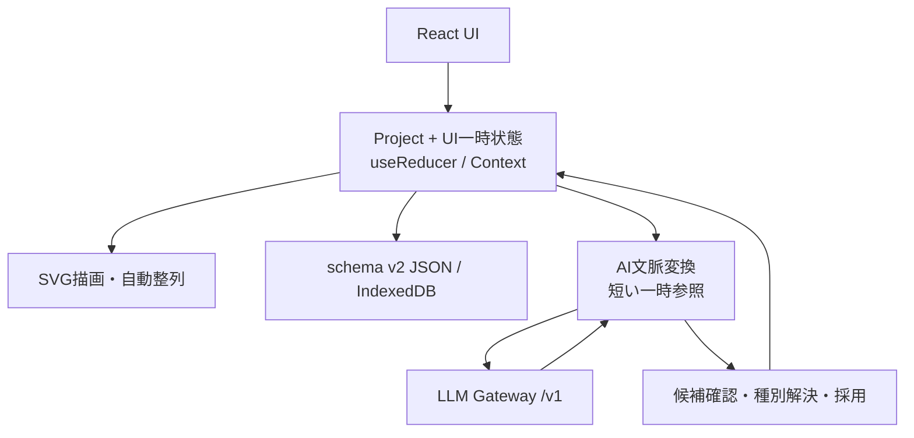

# 思考展開図エディタ (TPDD) リファレンスマニュアル

版: 2.0
対象データ: TPDD Project schemaVersion 2

## 第1章 システム概要

TPDD-Editorは、設計上の考えを抽象度列へ配置し、関係線と階層的な詳細図で整理するフロントエンド完結型エディタです。機械設計に限らず、ソフトウェア、電子回路、組織固有の設計手法へ合わせて種別と列を定義できます。

主な特徴は次のとおりです。

- Projectごとにノード種別と抽象度列を定義
- 機械設計、ソフトウェア設計、電子回路設計、カスタムの新規Projectプリセット
- 種別の意味と列の意味を分離した「設計体系」管理
- 標準SVGによる図編集、階層サブ図、自動整列、Undo/Redo
- AIによる展開案、同階層の代替案、図レビュー
- LLMに永続IDと候補エッジを生成させない簡潔な提案プロトコル
- schema v2 JSON保存、IndexedDB自動保存、SVG/PNG出力

### 1.1 種別と抽象度列

| 項目 | 意味 | 主な用途 |
|---|---|---|
| **種別** | ノードが何を表すか | 表示ラベル、色、AIによる内容分類 |
| **抽象度列** | どの設計段階・観点に置くか | 図上の横位置、自動整列、AI候補の配置先 |

両者は独立しています。同じ名称である必要も、1対1で対応する必要もありません。たとえば、ソフトウェア設計の「インターフェース」種別を「基本設計」と「詳細設計」の両方の列で使用できます。

### 1.2 クライアント内アーキテクチャ



## 第2章 画面構成

### 2.1 上部ツールバー

| 操作 | 説明 |
|---|---|
| 新規作成 | プリセットだけを選んで既定名称の空のschema v2 Projectを作成 |
| ファイル読込 | schemaVersion 2の `.tpdd.json` を検証して読込 |
| JSON保存 | Project全体をschema v2 JSONとして保存 |
| SVG / PNG / 全図SVG | 現在図または全図を共有用ファイルとして出力 |
| ノード追加 | 現在図へ下書きノードを追加 |
| エッジ結線 | 選択ノード間に関係線を作成 |
| 設計体系 | 種別と抽象度列を管理 |
| 自動整列 | 列順と列内の位置に沿って重なりを解消 |
| 全体表示 | 全ノードが画面内に収まるよう調整 |
| Undo / Redo | 最大50件の確定操作を取消・再適用 |

### 2.2 左ペイン

- Project名と説明。Project名をクリックするとProject設定を開いて編集可能
- ルート図と詳細図のツリー
- 図ごとのノード・エッジ件数
- 推論モデル選択、モデル探索、お気に入り
- Gateway接続設定

### 2.3 SVGキャンバス

- Projectの `levels` 配列順に抽象度列を左から右へ表示
- `nodeKinds` のlabelとpaletteKeyを使ってノードを描画
- ノード状態、関係線、サブ図リンクを表示
- ズーム、パン、複数選択、ドラッグ、インプレース編集に対応

### 2.4 右ペイン

**詳細タブ**では、ノードのラベル、内容の種別、配置する抽象度列、状態、説明、タグ、参考リンク、寸法、来歴を編集します。種別と列は別々の選択欄です。

**AI支援タブ**では、展開案、代替案、図レビュー、配置先列、追加指示、送信プレビュー、候補選択、未解決種別の修正を扱います。

## 第3章 設計体系

### 3.1 分野別プリセット

新規Project作成時だけ、次のプリセット識別子を使用します。識別子自体はProjectへ保存せず、選んだ定義を `nodeKinds` と `levels` へコピーします。

| プリセット | 識別子 | 用途 |
|---|---|---|
| 機械設計 | `mechanical` | 要求、機能、機構、構造などを起点とする構成 |
| ソフトウェア設計 | `software` | 要求、責務、論理設計、実装要素などを起点とする構成 |
| 電子回路設計 | `electronics` | 仕様、電気的機能、回路方式、部品などを起点とする構成 |
| カスタム | `custom` | 独自体系を構築するための最小構成 |

プリセット適用後の定義はすべて通常のユーザー定義として扱います。固定の分野横断用語への置換は行いません。

### 3.2 種別管理

種別はProjectの `nodeKinds` 配列で管理します。

- **名前**: 画面に表示する固有の用語
- **説明**: 種別の判断基準。AIにもデータとして送信
- **パレット**: Paul Tol Lightに基づく9色。ノード背景に使い、本文色は濃色に統一
- **順序**: 配列順。選択欄とAI参照の順序に使用

配列先頭の種別を新規ノードの既定種別として使用します。種別を削除する場合、使用中のノードを別種別へ再割当てし、未定義 `kindId` を残しません。

### 3.3 抽象度列管理

列はProjectの `levels` 配列で管理します。

- **名前**: 列ヘッダーに表示する名称
- **説明**: その列へ置く設計内容。AIにもデータとして送信
- **順序**: 配列順。左から右の表示順と自動整列に使用

列を削除する場合、所属ノードを別列へ再割当てし、未定義 `levelId` を残しません。

### 3.4 AI向け説明

LLMは名称だけでなく説明を使って種別と列の意味を判断します。独自用語や略語を使う場合は、対象と判断基準を具体的に記述してください。

```text
種別名: 非機能要件
説明: 性能、可用性、セキュリティ、保守性などの品質要求

列名: 論理設計
説明: 責務分割、状態遷移、データフロー、アルゴリズムを記述する段階
```

説明はLLMへの命令ではなく `<DATA>` 内の分析対象データとして送信されます。

## 第4章 図編集

### 4.1 ノード

ノードは次の主要属性を持ちます。

- `kindId`: Project内の種別定義を参照
- `levelId`: Project内の列定義を参照
- `status`: `draft` / `candidate` / `adopted` / `rejected`
- ラベル、説明、タグ、参考リンク
- 本文は画面とSVG出力で共通の幅（ノード幅 − 36px）で折り返します。
- 位置、寸法、任意の子図参照
- 手動またはAI生成の来歴

AI候補を図へ採用した直後の状態は `candidate` です。ユーザーが内容を確定した場合に `adopted` へ変更します。

### 4.2 エッジ

| ID | 表示 | 意味 |
|---|---|---|
| `decomposition` | 分解・具体化 | 上位概念から下位概念への展開 |
| `dependency` | 依存 | 実行順、情報、前提などの依存 |
| `constraint` | 制約 | 制約が対象へ及ぼす拘束 |
| `reference` | 参考 | 緩やかな関連付け。AI代替案ではラベル「代替」を使用 |

自己エッジと同一方向・同一種別の重複エッジは禁止します。

接続位置は自動で決まります。異なる抽象度列のノード間は左右の辺の中央、同じ列のノード間は上下の辺の中央を結びます。接続する側はノードの実際の位置に追従し、通常は直線、双方向の関係は互いに分離した曲線で表示します。

どの接続ポートからドラッグしても、ポートの選択は保存されません。ドラッグ中はカーソル方向の辺の中央から線を表示し、接続先ノードに重なると確定後と同じ接続位置・経路をプレビューします。画面、SVG、PNGで共通の計算を使用します。ノードの重なりや他のノードを避ける自動経路探索は行いません。

### 4.3 詳細図

ノードには1つの詳細図を関連付けられます。詳細図はProject内で共有せず、親ノードを1つだけ持ちます。親ノード削除時は子孫図をまとめて削除し、Undoで復元できます。

### 4.4 自動整列

列の配列順をX方向、各列内の既存順序をY方向として配置し、ノード同士の重なりを避けます。結果は1回のUndo単位です。

## 第5章 AI支援

### 5.1 タスク

| タスク | 意味 | 既定の配置先 | 採用時の接続線 |
|---|---|---|---|
| `expand` | 選択ノードを具体化する下位候補 | フォーカス列の次列。最終列では同じ列 | focus → candidate の `decomposition` |
| `alternatives` | 選択ノードを置き換える同階層候補 | フォーカスと同じ列 | focus → candidate の `reference`、ラベル「代替」 |
| `review` | 現在図の欠落、矛盾、曖昧さ、要検証事項を診断 | 候補ノードを生成しない | 生成しない |

展開・代替の配置先は共通のselectで実行前に変更できます。1回の実行では全候補を1つのターゲット列へ置きます。

別機能として、AI支援パネルの **「説明文生成（実験的）」** ボタンから、選択した起点ノードを報告書用に説明できます。図レビューのように問題点を列挙する機能ではありません。

### 5.2 AIへ送る意味情報

展開・代替では、フォーカスと1-hop近傍に加えて次を送ります。

- ユーザー定義種別のlabelとdescription
- 種別ごとの短い一時参照 `K1`、`K2`、...
- 確定したターゲット列のlabelとdescription
- ターゲット列へ適した同一抽象度の候補だけを出す指示

Project内の種別ID、列ID、候補ID、候補エッジをLLMに生成させません。一時参照はリクエスト内だけで使用し、Projectには保存しません。

### 5.3 提案応答

提案応答は要約と候補ノードだけを含みます。候補のラベル以外は省略可能で、安全な既定値を補います。

```json
{
  "summary": "提案の要約",
  "nodes": [
    {
      "label": "認証状態管理",
      "kindRef": "K2",
      "description": "認証状態と遷移を管理する",
      "rationale": "責務を分離するため",
      "assumptions": [],
      "checks": []
    }
  ]
}
```

応答に `candidateId`、`levelId`、`edges`、Project内UUIDは不要です。候補の一時IDは受信後にアプリが付与します。

### 5.4 未知kindRefの修正

存在しない、欠落した、または解決できない `kindRef` は、応答全体を失敗させません。該当候補を「種別未設定」として表示します。

- 候補カードの種別selectでユーザーが修正
- 選択中かつ種別未設定の候補だけ採用不可
- 未選択の未解決候補は、他候補の採用を妨げない

不正JSONなど候補配列そのものを解釈できない場合は推論エラーです。形式修正の自動再問い合わせは行いません。

### 5.5 説明文生成（実験的）

選択した起点ノードから、明示的な分解エッジと、そのノードに紐づく詳細図をたどり、説明文の草稿を作ります。送信前に対象ノード・エッジ・図の件数と内容を確認できます。対象の上限は200ノード、400エッジ、1MBです。上限を超える場合は範囲を分けてください。

生成文はMarkdownとして編集、コピー、保存できます。各AI生成段落には一時参照の根拠を付け、根拠一覧と図に記録された分解経路はアプリが組み立てます。範囲外の参照や、分解エッジを根拠に含まない分解説明・実現案は除外します。参考・代替、依存、制約の線だけを根拠とする実現案は採用しません。検証で一部の記述を除外した場合、その警告も保存文書に含めます。根拠を通過した記述がない場合は生成エラーとして扱います。

この機能は設計図に記録された内容を説明する実験的な草稿生成です。根拠参照が付いていても文章の意味的な正しさは自動保証されず、設計の妥当性、実装完了、試験結果を証明しません。原図と根拠を確認してから利用してください。

### 5.5 候補エッジ

LLMは候補エッジを返しません。アプリがタスクに応じてfocusから各採用候補への線を生成します。これにより、ノードIDを列IDへ誤用する、候補参照を取り違える、未選択候補への線が残る、といった参照エラーを構造的に除去します。

候補間の依存・制約は説明または確認事項へ記述させます。図として必要な線は採用後にユーザーが追加します。

### 5.6 採用と競合保護

推論開始時にProject、revision、diagram、focus、target level、task、modelの文脈を固定します。採用時に再検証し、図の編集・切替・参照削除などで一致しない場合は再生成を促します。現在選択中の別ノードへ接続先を差し替えることはありません。

選択候補のノードとアプリ生成エッジを一括でProjectへ合成し、件数上限とProject全体の参照整合性を検証してから1回のUndo単位で確定します。

### 5.7 プロンプトインジェクション対策

ユーザー入力、ノード、種別説明、列説明はすべて `<DATA>` 内のデータとして送信します。システム命令と分析対象を分離し、Projectのテキストを命令として実行しないよう指示します。AI出力は画面・SVGともプレーンテキストとして扱います。

## 第6章 schemaVersion 2

概略モデルは次のとおりです。

```ts
interface Project {
  format: 'tpdd-project';
  schemaVersion: 2;
  id: string;
  title: string;
  description: string;
  createdAt: string;
  updatedAt: string;
  rootDiagramId: string;
  nodeKinds: NodeKindDefinition[];
  levels: LevelDefinition[];
  diagrams: Diagram[];
  aiPreferences: AiPreferences;
}

interface NodeKindDefinition {
  id: string;
  label: string;
  description: string;
  paletteKey: string;
}

interface LevelDefinition {
  id: string;
  label: string;
  description: string;
}

interface ThoughtNode {
  id: string;
  label: string;
  kindId: string;
  status: 'draft' | 'candidate' | 'adopted' | 'rejected';
  levelId: string;
  x: number;
  y: number;
  width: number;
  height: number;
  childDiagramId?: string;
  meta: {
    description: string;
    tags: string[];
    sourceLinks: string[];
  };
  provenance: Provenance;
}
```

配列順を種別と列の表示順に用いるため、別の `order` フィールドは持ちません。新規ノードは `nodeKinds[0]` を既定種別として使用します。

### 6.1 非互換方針

schemaVersion 2だけを読み込みます。schemaVersion 1以前、`thought-expansion-project`、旧 `.thought.json`、旧IndexedDBスナップショットを変換するマイグレーターは持ちません。非対応データは現在のProjectを変更せず、対応版が違うことを明示して拒否します。

## 第7章 保存・復旧・出力

- **JSON保存**: 検証済みschema v2 Projectを `.tpdd.json` として保存
- **自動保存**: 確定編集後にIndexedDBへ保存し、schema v2だけを復旧候補として表示
- **SVG出力**: 動的種別のlabel、paletteKey、列labelを使用した標準SVG
- **PNG出力**: 現在図を高解像度ラスタ画像として保存

Gateway Token、選択状態、viewport、モーダル状態、Undo履歴はProject JSONへ含めません。

## 第8章 主なショートカット

| 操作 | キー |
|---|---|
| Undo | `Ctrl` / `Cmd` + `Z` |
| Redo | `Ctrl` / `Cmd` + `Y` または `Ctrl` / `Cmd` + `Shift` + `Z` |
| ノード名編集 | 選択中に `F2` |
| 削除 | `Delete` / `Backspace` |
| 位置微調整 | 矢印キー。`Shift` 併用で10px |
| 一時操作中止 | `Escape` |
| パン | 中ボタンドラッグ、または `Space` + 左ドラッグ |

## 第9章 トラブルシューティング

### schemaVersion 1のファイルを開けない

schema v2は開発中の単純なデータモデルを優先しており、旧版との互換性を提供しません。旧データが必要な場合は、そのデータを作成した版で退避してください。

### AI候補に「種別未設定」と表示される

LLMが有効な `kindRef` を返せなかった状態です。候補カードでProject内の種別を選択すると採用できます。これはProject破損ではありません。

### AI候補の配置列が意図と違う

生成前の配置先selectを確認してください。独自名称の列では、設計体系画面で列のdescriptionも記述すると提案内容が安定します。

### AI提案に候補間の線がない

候補参照エラーを防ぐため、LLM生成エッジは廃止しています。focusから候補への基本線はアプリが生成します。候補間の依存・制約は説明と確認事項を読み、必要な線を手動で追加してください。

### Gatewayへ接続できない

既定接続先は `/v1` です。Gatewayと上流モデルの起動、認証Token、許可Origin、モデルIDを確認してください。
